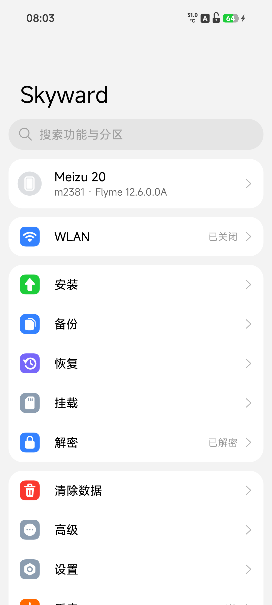
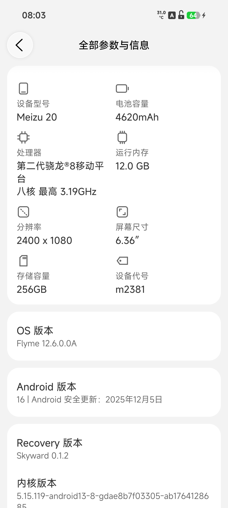
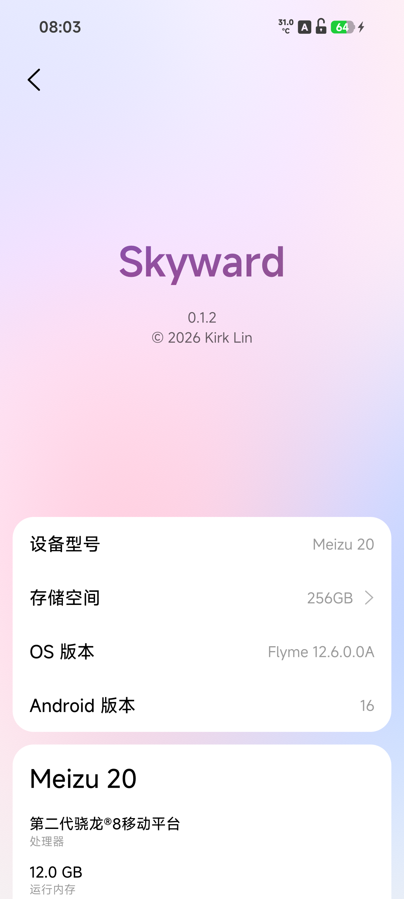

# Skyward — 魅族 20(m2381)移植版

一个使用 Rust 从零编写的 Android recovery,来自 [kirklin/skyward](https://github.com/kirklin/skyward) 的移植,为**魅族 20**适配。

<p align="center">
  
  
  
</p>

它构建在魅族原厂 recovery 之上:替换原厂 ramdisk 里的 recovery 二进制,内核与驱动保持原厂,并按 `devices/m2381.toml` 的声明,以 recovery 域拉起原厂 vendor 服务(TEE、密钥、槽位控制),从而解密 data、点亮 WLAN、读到电池。

## 功能(已在真机验证)

- 解密 data 分区:高通 wrappedkey 方案,fscrypt v2;用户各自的加密文件全部可读
- 屏幕、触摸(Goodix)、背光
- 电池电量、充电状态与温度(ADSP 自动拉起,电池固件在其上)
- MTP 文件传输(与 adb 并行)、adb(免授权 root shell)、`adb sideload`、fastbootd
- WLAN(kiwi_v2 + cnss2,连接与联网探测)
- 安装刷机包、OTA 与分区镜像(内部存储 / U 盘 / sideload)
- 备份与恢复(含 modemst1/2、fsg、fsc、persist 等 EFS)、清除数据、挂载、终端、截图
- 重启到系统、recovery、fastboot、bootloader、EDL;切换 A/B 槽位
- 浅色与深色主题,简体中文、繁体中文、英文

### 已知不工作

- 振动(AW8697 马达没有内核力反馈接口,TWRP 在此机同样不振动)
- 在线系统更新(Flyme 的 OTA 接口未接;用「安装」页刷 OTA 包代替)

## 支持的机型

| 机型 | 代号 | 验证基线 |
| --- | --- | --- |
| 魅族 20 | `m2381` | Flyme 12.6.0.0A(内核 5.15.119;页面上的 OS / Android 版本来自已装系统) |

## 安装

需要已解锁的 bootloader。fastboot 下把镜像刷入**当前槽位**的 recovery 分区:

```sh
fastboot flash recovery_a skyward-m2381-v0.1.2.img   # 槽位以 fastboot getvar current-slot 为准
fastboot reboot recovery
```

回退原厂:刷回 stock recovery 镜像即可(`fastboot flash recovery_a stock-recovery.img`)。打开「自动重新刷入 Skyward」后,系统更新覆盖 recovery 分区时会自动刷回。

> ⚠ 安全须知:recovery 中的 adb 是免授权的 root shell(上游设计,便于救砖)。手机处于 recovery 时,拿到手机和数据线的人可以访问其中的存储。

## 构建

手机侧二进制与打包器分别构建(recovery 的配置解析依赖 unix 路径语义,打包在 Linux/WSL 进行):

```sh
# 手机侧(Windows/Linux 均可,NDK r29 + cargo-ndk)
cargo ndk -t arm64-v8a --platform 30 build --release -p skyward

# 打包器(WSL/Linux)
cargo build --release -p skyward-pack
```

`--stock` 使用真机 `dd` 出的 recovery 分区整区(含 AVB footer)。打包器替换其中的 recovery 二进制、注入设备配置与字体,并向 `prop.default` 追加 `sys.usb.config_disable=0` 等属性:

```sh
skyward-pack recovery \
  --stock stock-recovery.img \
  --binary target/aarch64-linux-android/release/skyward \
  --config devices/m2381.toml \
  --font resources/fonts/MiSansVF.ttf \
  --mono resources/fonts/KirkMono-Regular.ttf \
  --mono-license resources/fonts/KirkMono-OFL.txt \
  --out skyward-m2381.img
```

测试与代码检查在 Linux/WSL 上运行:

```sh
cargo test --workspace
cargo ndk -t arm64-v8a --platform 30 clippy -p skyward -p skyward-install -- -D warnings
```

## 相对上游的差异

| 文件 | 差异 | 原因 |
| --- | --- | --- |
| `devices/m2381.toml` | 魅族 20 设备配置 | vendor 服务凭证照抄 Flyme 的 init rc;ADSP oneshot 启动电池计;WLAN kiwi_v2;触摸 goodix_ts |
| `crates/skyward/src/ui.rs` | `normal_max()`:面板设备树没有 MIUI 亮度属性时,回退为全量亮度范围 | 魅族面板节点没有 `mi,*` 属性,原实现直接报错导致 UI 无法启动 |
| `crates/skyward-crypto/src/data.rs` | 元数据加密的裸 `wrappedkey` 标志按 AOSP 默认值回退 | 防御性:m2381 的 fstab 为标准写法,此补丁兜底其他机型 |
| `crates/skyward-pack/src/main.rs` | `prop.default` 追加 `sys.usb.config_disable=0` | Flyme 的 stock recovery 不设置该属性,`skyward-mtp.rc` 中带此条件的规则永不触发,文件传输无法绑定 |

移植过程、真机取数记录与风险登记见 [docs/PORTING.md](docs/PORTING.md)。

跟进上游:

```sh
git fetch upstream
git rebase upstream/main   # 差异刻意保持最小,冲突面很小
```

## 安全

recovery 中的 adb 无需授权即可获得 root。Skyward 打包器还将 `ro.secure=0`、`ro.adb.secure=0` 写入 recovery 的属性文件。这是有意的权衡:recovery 是救砖的最后一道门,不该有进不去的情况;代价是丢失手机的人也能读到其中的存储。请自行权衡。

## 致谢与许可证

一切核心架构归功于 [Kirk Lin](https://github.com/kirklin) 的 [skyward](https://github.com/kirklin/skyward),以及其文档的写作方式——本仓库的多数机制说明也得益于此。

以 [GPL-3.0-or-later](LICENSE) 发布,与上游一致。
